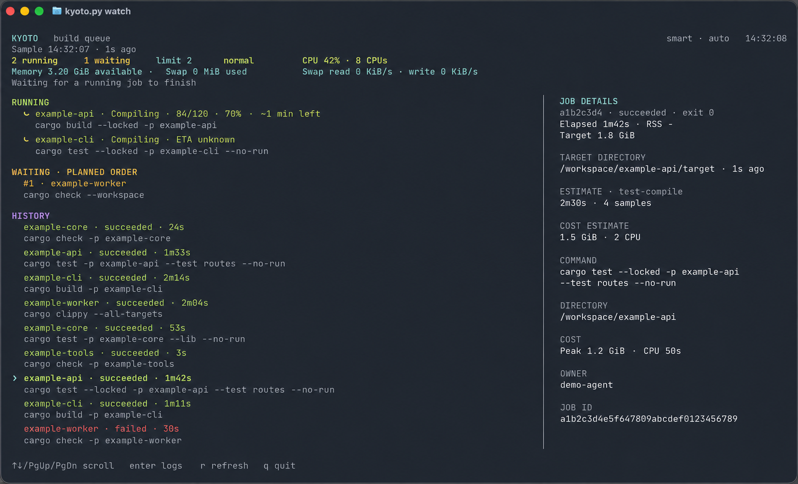

# Kyoto

A local command queue for Rust builds across projects and agents. Kyoto schedules
jobs with automatic concurrency, monitors memory pressure and swap activity,
and provides a live terminal dashboard. Cargo manages its own build locks.

Kyoto lets local agents coordinate their Rust builds and tests through a shared
queue, reducing resource contention across projects and worktrees.

Requires Python 3.9+ on macOS or Linux. No Python packages to install.



## Install

```sh
git clone https://github.com/Jagalite/kyoto.git
cd kyoto
```

Add the checkout directory to your shell's `PATH` to use Kyoto in future terminals.

## Run

Humans can watch the live queue:

```sh
kyoto.py watch
```

Agents can run the following commands from their project directory:

```sh
kyoto.py submit -- cargo check --workspace  # Submit a Rust command
kyoto.py plan -- cargo build --release      # Preview cost and queue position
kyoto.py status                             # View the shared queue
kyoto.py show JOB_ID                        # Inspect a job
kyoto.py logs JOB_ID                        # Read its output
kyoto.py wait JOB_ID                        # Wait for completion
kyoto.py cancel JOB_ID                      # Cancel an owned job
kyoto.py history                            # View completed jobs
kyoto.py restart                            # Reload worker code, preserving builds
```

## Tests and scheduling

Submit `cargo test` or `cargo bench` normally, without a compilation-only flag.
Kyoto chooses compilation only or compilation plus execution from the shared
policy. The default is compilation only, which the returned `policy_message`
explains. After compilation, run tests and benchmarks outside Kyoto, or
explicitly change the shared admin policy:

```sh
kyoto.py submit -- cargo test                           # Compile only under default policy
cargo test                                            # Run directly after compilation
kyoto.py config --mode fifo --max-running 2             # FIFO, two concurrent jobs
kyoto.py config --mode smart --max-running auto         # Restore defaults
```

Memory pressure can delay new starts. Estimates are approximate. Commands that
need additional serialization can request `submit --resource /shared/path`.
Use `kyoto.py --help` or `kyoto.py SUBCOMMAND --help` for options.

Kyoto assigns each job a log file and returns its path in the JSON `log` field.
There is no custom per-job log-path option. To save output elsewhere, use
`kyoto.py logs JOB_ID > chosen-file.log`; this exports output captured so far.

Queue state and logs default to `~/.local/state/kyoto`. All participating agents
should use the same state directory. The database stores full job environments;
keep it and job logs private and out of Git.

After updating worker code, run `python3 kyoto.py restart`. The coordinator
accepts a session-specific request between scheduling passes, closes its own
database/lock handles, and reloads the code. Independent job runners keep their
processes, attempt IDs, logs, and exit results; queue settings and queued jobs
remain intact. The command waits for a fresh, recovery-ready replacement session
before reporting success. Reopen `watch` separately to load dashboard changes.

`restart --timeout 30` bounds the wait. A timeout means replacement readiness
was not verified, not that builds were stopped. An unconsumed request expires
and is withdrawn by the caller. Workers older than this restart protocol return
an explicit unsupported message; they must first be replaced through the
existing worker lifecycle. The command never falls back to killing processes.
If the OS denies a build cancellation/deferral signal, the worker keeps tracking
the job, reports the error in the job and `health.runtime.signal_errors`, and
retries at ten-second intervals instead of crashing.

The test restriction recognizes Cargo commands and common wrappers; it does not
inspect arbitrary shell scripts or custom aliases. Do not submit test execution
through those wrappers.

## Progress-driven hill climbing

The `hill-climb` mode uses the production controller, including bounded
telemetry recovery. It is not the research adapter. Smart remains the default.
See [the controller contract and qualification results](docs/HILL_CLIMBING.md).

**General convergence and workload-specific hardware performance are not guaranteed.**
Closed-loop model tests now settle near the known optimum for finite workloads,
including noisy observations and mixed job sizes. Sparse counters and changing
workloads remain imperfect, and a rejected extra slot stays occupied until a
running command finishes. See the [reproducible convergence audit](experiments/README.md)
for comparisons with the original implementation and the remaining limits.

`hill-climb` learns a concurrency limit from **progress per command** and measured
CPU use, available RAM, swap activity, and disk latency/contention. Smart mode
remains the default. Evaluate this mode in its own queue first, using the same
`--state` path for every command:

```sh
python3 kyoto.py --state ~/.local/state/kyoto-hill-climb config --mode hill-climb --max-running auto
python3 kyoto.py --state ~/.local/state/kyoto-hill-climb submit -- cargo check --workspace
python3 kyoto.py --state ~/.local/state/kyoto-hill-climb health
python3 kyoto.py --state ~/.local/state/kyoto-hill-climb watch
```

The controller starts with one slot, measures a stable window, and tries one
additional slot when work is waiting. Every command with a known phase total
contributes its measured `delta / total / seconds`; these completed phase
fractions are summed and adjusted for resource pressure. New commands contribute
their actual measured progress. An upward trial needs at least a 5% improvement;
a downward trial can keep within 3% of the prior score while using fewer slots.
No incumbent may fall below 25% of its prior rate in an accepted trial.

Observation windows start at ten seconds and extend up to ninety seconds when
counters have not advanced, with twenty seconds between trials. After a rejected
trial the controller holds its measured limit. A changed command or phase, or a
sustained rate change exceeding 35% over at least sixty measured seconds, can
reopen exploration. Holds caused by the configured cap or CPU/RAM headroom are
released when that constraint relaxes. Downward changes drain as commands finish;
the optimizer does not
stop a running command to conduct a trial. Existing pressure-triggered deferral
still applies to retry-eligible commands when enabled. Short-job preemption is
specific to smart mode. Explicit resource locks and aging continue to apply.

`--max-running N` is an upper bound in this mode; `auto` uses `--cpu-budget` as
its upper bound. Missing totals, progress, or resource measurements normally
keep admission at one slot. A brief disk-sensor interruption after a measured
limit has been learned instead closes admission for at most ten seconds while
retaining that limit. It discards the interrupted rate window and probe; recovery
starts fresh measurements. Retry/phase/counter changes, a reduced cap, memory or
swap pressure, and worker restarts cannot inherit this grace. Repeated sensor
flicker cannot renew it without a productive measured window. A persistent outage
returns to the one-slot fallback. Running commands are never stopped by this
telemetry mechanism. A newly admitted command has bounded startup time
to report its first counter during an upward trial or an ordinary refill of a
learned limit (120 seconds by default). Refill grace requires a measured surviving
incumbent. Known commands losing progress do not get this grace period.
Phase transitions, retries, counter resets, workload changes, and worker restarts
require new measurements. Ordinary completions preserve the learned limit.
No optimizer state is carried
across worker restarts. The dashboard shows the current decision; `health`
includes `runtime.hill_climb` diagnostics (target, actual running count, drain
duration, measured rates, hold cause, trial decisions, qualified limit, telemetry
state, and whether admission is paused for telemetry) and `runtime.job_progress` for each
running command. `show` and `status` expose progress and its source as well.

Cargo progress bars, libtest results, Cargo JSON artifact messages, and ordinary
`Compiling`/`Checking` lines are recognized automatically. Crate-start counts are
an activity proxy; they do not mean that crates have finished. Counts and
percentages refer to the current phase or test suite, not the whole command.
Unknown-total counters remain progress diagnostics and cannot justify extra
concurrency. Commands with no recognized output explicitly report unavailable progress.
Elapsed time, CPU consumption, and output bytes do not count as useful work.

Any command or wrapper can report its own work counters by writing and flushing
a line to stdout or stderr:

```text
KYOTO_PROGRESS {"completed": 42, "total": 100, "phase": "encoding"}
```

`completed` must be finite and nonnegative; `total`, when supplied, must be
positive and at least `completed`. Omit `total` when only a count is known.
Keep the phase and units stable while reporting increasing counters, and change
the phase when the meaning of a work unit changes. An optional `epoch` string
can distinguish repeated batches with the same phase. Emit periodically,
including an initial zero. Kyoto reads existing logs; it does not alter the
command or run an extra progress probe. Buffered output delays feedback, so flush it.

The objective gives each phase equal weight. It measures phase completions per
second, not a universal work unit: a short test phase and a large build phase
each count as one. Different phase sizes, job mixes, and outside workloads can
change the preferred concurrency. Unknown totals never acquire invented
denominators. Disk telemetry currently requires macOS; unavailable telemetry
prevents aggressive exploration. Planning remains a snapshot at the current
limit, not a prediction of future optimizer decisions.

To return this queue to the default policy:

```sh
python3 kyoto.py --state ~/.local/state/kyoto-hill-climb config --mode smart --max-running auto
```

## Shared command policy

```sh
kyoto.py policy show
kyoto.py policy allow test                         # Admin enables test execution
kyoto.py policy deny clean
kyoto.py policy deny build --param profile --value release
kyoto.py policy require build --param locked
kyoto.py policy limit '*' --param jobs --max-value 4
kyoto.py policy deny test --scope args --param nocapture
kyoto.py policy remove RULE_ID
kyoto.py policy preset compile-only                # Replace rules with defaults
```

Rules are persistent and shared across projects. The **last matching rule wins**.
`allow`/`deny` match a command, an optional parameter, and an optional exact
value. `require` denies a command missing the parameter/value; `limit` denies
present values that are not positive integers within the maximum. Parameter
names omit leading dashes. Quoted command globs such as `'*'` are supported.
Rules inspect supplied arguments, not values inherited from Cargo configuration
or environment variables. Rules normalize Cargo aliases, short flags and `--name=value`; `--release` also
matches `profile=release`. Repeated values are all checked. `--scope cargo` is
the default; `--scope args` examines arguments following Cargo's `--` separator.
Cargo help/version requests are exempt from `require` rules.

The initial preset allows commands but limits tests and benchmarks to compilation.
Callers submit ordinary `cargo test` and `cargo bench` commands; Kyoto handles
the Cargo compilation flag internally. Other policy denials still apply.
JSON responses include `requested_command`, the effective `command`, and a
`policy_message` explaining automatic compilation-only behavior. The message
persists in `show`, `wait`, and history results, including after completion.
Existing queued commands are still rechecked, not rewritten, after policy changes.
Documentation-only tests (`cargo test --doc`) require execution permission: Cargo
cannot compile them separately without running them, so compile-only submissions
are rejected with an explanation.
`policy allow test` overrides that requirement; benchmark permission is separate.
For a command allowlist, use `policy preset deny-all`, then add `allow` rules.
`policy preset allow-all` removes all restrictions. Presets replace existing rules.
An allow rule for one parameter value does not deny other values by itself;
use a deny rule first, a `require` rule, or the deny-all preset as appropriate.

Planning and submission check the policy. Policy edits immediately reject queued
jobs that no longer qualify, and workers recheck before launch. Rejected jobs
finish with an error explaining the rule; running jobs continue. Enabling tests
does not grant automatic retry permission. These are local operator controls,
not authenticated admin accounts. Rules inspect recognizable Cargo invocations,
not arbitrary shell scripts or code inside build scripts/custom aliases.

## Automatic deferral

Smart mode prioritizes jobs estimated at **under ten minutes**, using an explicit
`--estimate` or successful-run history. Generic command-class priors do not justify
short-job preemption. When a short job cannot fit, Kyoto can stop one retry-eligible
build estimated at ten minutes or more (or already running that long), provided
removing it makes room. A running build with 0–120 positive estimated seconds left
is protected; an overdue estimate means unknown remaining time. No new job starts
until the stopped attempt has exited. The short job gets priority over aged long
jobs; the displaced job waits for that short job to finish or leave the queue,
as well as its retry cooldown. This preference survives coordinator restarts.
Tests/benchmarks that execute code are never automatically preempted. FIFO mode
retains FIFO admission. `--auto-defer off` disables automatic preemption.

Kyoto stops and requeues one eligible build at a time when memory pressure is
warning/critical or swap reads/writes reach 64 KiB/s. It requires six stressed
seconds within a rolling ten-second window, so repeated bursts count. Occupied
swap alone is not a trigger. It waits at least ten seconds between stops and
stops reducing concurrency when pressure eases or only one uncancelled job remains.

New starts resume on the first healthy host sample, with no extra pressure
recovery cooldown. Automatic mode admits at most one additional job per healthy
sample (normally every two seconds), above the number already running and within
the observed-load ceiling. It does not slowly rebuild slots already occupied by
surviving jobs. Active memory/swap pressure still blocks new starts; sustained
pressure triggers the deferral system below. Fixed concurrency returns to its
configured cap as soon as pressure clears.

It favors jobs with more measured RSS and less elapsed work, sends TERM then
KILL if needed, and waits for the process group to exit before releasing its
slot. Deferred jobs wait at least 60 seconds plus pressure recovery before
retrying. There is no per-job deferral cap: a retried build can be deferred again
if pressure returns. New starts use the same swap threshold. This cannot prevent
swap caused by other applications or by the one remaining build.

Build, check, clippy and compile-only test/benchmark commands are eligible.
Other commands require explicit retry permission. Test/benchmark
execution requires a policy change and is excluded from automatic deferral:

```sh
kyoto.py submit --allow-retry -- ./repeatable-build.sh
kyoto.py config --auto-defer off
kyoto.py attempts JOB_ID
```

Retries retain the same job ID and owner, and `wait` keeps waiting. Logs are
appended with retry markers. Deferred attempts retain timing and resource
records but do not enter successful duration history; the eventual successful
attempt is measured separately. User cancellation overrides requeueing.
Completed Cargo artifacts remain reusable. Build scripts can rerun, so disable
auto-deferral if a build performs work that must not be repeated.

## Worker recovery

Commands automatically restart a missing scheduler for an existing queue,
including `watch`, status commands, and `plan`. The dashboard and `wait` keep
checking while open. A preview can recover the existing queue but never submits
its proposed job. Status commands wait briefly for stale job states to be reconciled and exit
with code 3 if recovery is incomplete, rather than presenting unverified states.
The dashboard recovers in the background and remains responsive. Readiness is
bound to the current worker instance, not just a recent timestamp.
Each new job runs under an independent runner that saves its
process identity and exit result in the state directory. Restarting the scheduler
preserves running jobs, their slots, explicit resource locks, and cancellation.
Build processes do not hold the scheduler lock.

Jobs started by older Kyoto versions can be monitored without stopping them.
If their original worker exited, their final exit code is unavailable: Kyoto
marks them `interrupted` once they stop, rather than assuming success or rerunning
them. The same applies if a new job loses its runner and no exit result survives.
Do not delete lock files to recover the scheduler.

## Development

Agents are encouraged to modify these scripts to change whatever they want,
including scheduling, resource controls, commands, and the dashboard. Adapt Kyoto
to your own workflows and preferences.

```sh
python3 -m unittest discover -s tests -v
# Include the optional real Cargo smoke test:
KYOTO_TEST_CARGO=1 python3 -m unittest discover -s tests -v
```

### Disk I/O diagnostics

`python3 kyoto.py io --interval 3 --samples 10` emits live JSON samples without
starting/restarting a worker or changing the queue. It includes physical-device
read/write MiB/s, IOPS, average operation times in milliseconds, CPU usage,
memory pressure, running jobs' source/target device mappings, and Cargo progress.
Target paths come from bounded, offline Cargo metadata; unresolved mappings are
reported rather than guessed. A lock-wait phase means Cargo's latest recognized
log event reported a file lock; it is not a kernel-level lock probe.

On macOS, disk counters come from IOKit. Average operation times use deltas of
[Apple's cumulative nanosecond counters](https://developer.apple.com/documentation/iokit/kioblockstoragedriverstatisticstotalreadtimekey)
divided by completed operations. `io_time_per_second` sums operation time per wall
second: concurrent requests can make it exceed one. It is **not** disk busy
percentage or a measured queue depth. These are whole-device observations, not
per-job attribution; zero completed operations have unknown average latency.
Counter resets, device replacement, initial samples, and collection failures do
not become false zero-latency readings. Other platforms report unavailable.

New workers publish disk metrics in `health` and `watch`; an already-running
worker retains its loaded code until its next normal restart. The `io` command
works immediately with existing workers. With pressure control enabled, any
physical disk with read or write operation times averaging at least 50 ms, at
least 10 corresponding operations per second, and summed I/O time of at least
one second per wall second caps admission at one running job. This is a
conservative host-wide heuristic, not per-job I/O attribution. Sustained disk
pressure uses the existing six-in-ten-second deferral window and ten seconds
between stops to reduce eligible builds one at a time, preserving at least one
uncancelled job. Disk-only deferral favors long builds and protects those expected
to finish within two minutes. Memory/swap relief may still need to interrupt them.
Healthy samples restore gradual admission; missing disk telemetry does not invent
pressure. Use `python3 kyoto.py restart` to activate updated worker code.
